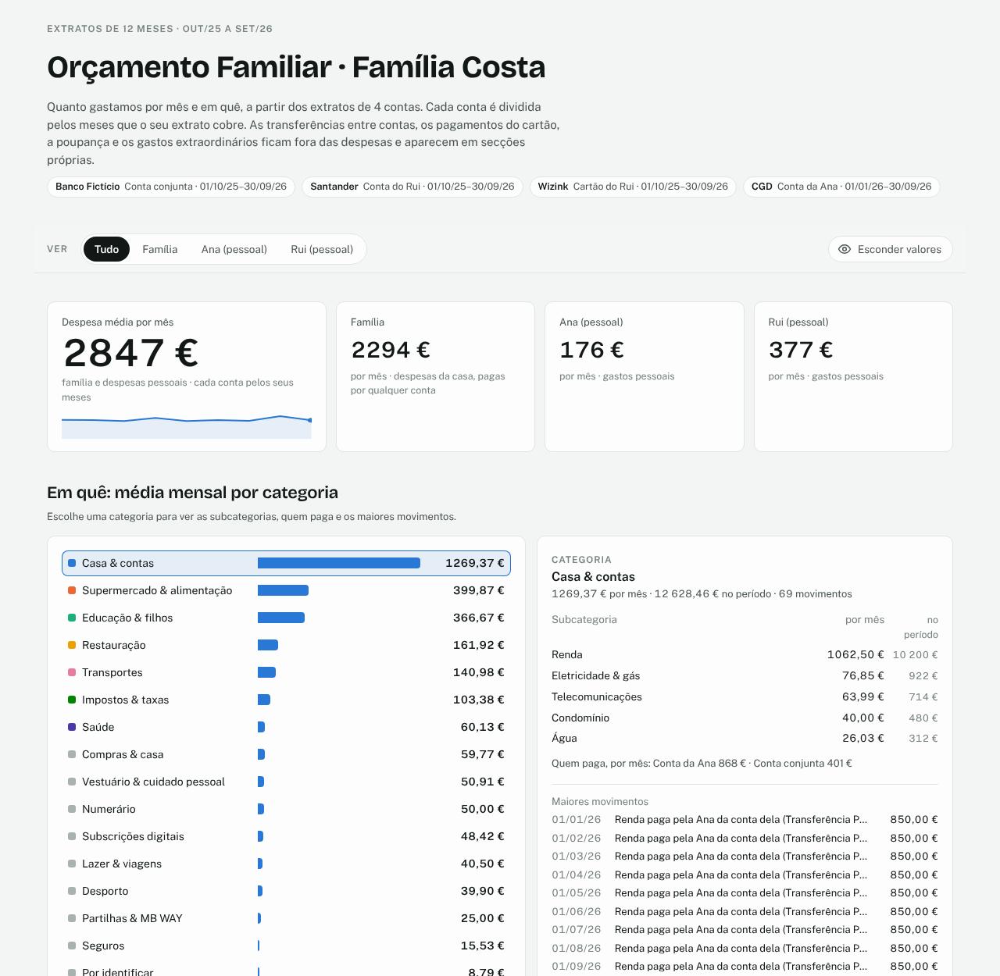

# Orçamento Familiar · skill para o Claude

Transforma os extratos bancários da família num dashboard de orçamento familiar. Tudo numa conversa com o Claude: ele lê os extratos, pergunta como a família organiza as contas, categoriza as despesas, identifica os movimentos estranhos contigo, compara com o orçamento planeado, calcula quanto cada um contribui e sugere onde poupar.

Pensada para famílias em Portugal: lê extratos de bancos portugueses (CSV, Excel ou PDF) e conhece centenas de comerciantes e serviços portugueses. Identifica empresas desconhecidas pelo Racius e pelo código CAE. Tudo em português europeu.



*Exemplo com uma família e dados inventados.*

## O que o dashboard mostra
- **Despesa média mensal:** da família e de cada pessoa. Cada conta é dividida pelos meses que o seu extrato cobre.
- **Categorias e subcategorias:** quem paga cada uma e os maiores movimentos.
- **Evolução mês a mês:** gráfico e tabela, com os meses incompletos assinalados.
- **Orçamento planeado vs real**, ou uma proposta de orçamento a partir das médias.
- **Contribuições para a família:** o que cada pessoa transfere para a conta conjunta e o que paga diretamente.
- **Divisão justa:** a meias ou proporcional ao rendimento.
- **Sugestões de otimização com valores dos extratos:**
  - subscrições duplicadas;
  - aumentos de preço;
  - comissões;
  - despesas anuais para reservar.
- **Cartão refeição:** com uso individual, nas despesas da família ou misto. Mostra quanto é carregado, quanto é gasto e que parte paga a família.
- **Imóveis arrendados:** rendas e custos de cada imóvel, com o resultado por mês, fora das despesas da família.
- **Fora das despesas:** rendimentos, poupança, extraordinários, adiantamentos reembolsados, custos fixos e o que não aparece nos extratos (cheque-creche, seguro de saúde da empresa, despesas pagas pelos avós).
- **Privacidade dentro da família:** os gastos pessoais podem aparecer em detalhe, só por categoria ou só pelo total.
- **Pesquisa de todos os movimentos.**
- **Botão com um olho:** esconde todos os valores e desfoca as descrições, para partilhar screenshots.

## Como funciona
1. **Extratos:** indicas a pasta dos extratos ou anexa-los à conversa.
2. **Perfil da família:** o Claude pergunta quem tem que contas, se há conta conjunta, de onde vem o dinheiro do orçamento, se há cartão refeição e como é usado, e o que fica fora dos extratos. Só pergunta pelas situações que se aplicam: imóvel arrendado, pensão de alimentos, trabalho independente, despesas de trabalho reembolsadas, adiantamentos a amigos, mudanças de vida.
3. **Categorias:** propõe uma categorização e ajusta-a contigo.
4. **Movimentos desconhecidos:** pesquisa-os e depois pergunta-te, em pequenos lotes.
5. **Orçamento:** pergunta se tens um orçamento mensal para comparar.
6. **Contribuições:** calcula as contribuições e a divisão justa.
7. **Sugestões:** sugere otimizações com base no que viu.
8. **Dashboard:** gera o dashboard.
9. **Lembrete mensal:** se quiseres, cria uma tarefa agendada no Claude que, todos os meses, verifica se já há extratos novos e atualiza o dashboard (ou pergunta-te por eles).

No mês seguinte, basta juntar os extratos novos: as regras e as decisões ficam guardadas e só aparecem perguntas sobre movimentos novos. O dashboard é atualizado no mesmo link e pode mostrar sempre os últimos 12 meses. Quem quiser pode automatizar a recolha dos movimentos com a [Enable Banking](https://enablebanking.com/) (ver `references/enable_banking.md`).

## Instalar
A skill segue o padrão aberto [Agent Skills](https://agentskills.io): uma pasta com um `SKILL.md`, scripts e ficheiros de referência. Funciona no Claude, no ChatGPT, no Gemini e no Microsoft 365 Copilot, mas as plataformas não oferecem as mesmas capacidades.

| Plataforma | Corre os scripts | Instala pacotes em falta | Como recebes o dashboard | Testado |
|---|---|---|---|---|
| Claude (claude.ai, app de computador, Claude Code) | Sim | Sim | Link privado (artifact) ou ficheiro HTML | Sim |
| ChatGPT (Business, Enterprise, Healthcare, Edu) | Sim | Não documentado | Ficheiro HTML | Não |
| App Gemini (contas Google pessoais) | Sim, sem internet | Não documentado | Ficheiro HTML | Não |
| Gemini CLI e Antigravity CLI | Sim, no teu computador | Sim | Ficheiro HTML | Não |
| Microsoft 365 Copilot (agentes, pré-visualização) | Sim, sem internet | Não | Ficheiro HTML | Não |

**Descarregar:** há dois zips na pasta [`dist/`](dist/):
- [`orcamento-familiar-claude.zip`](https://github.com/manfaria/orcamento-familiar/raw/main/dist/orcamento-familiar-claude.zip): para o Claude, que quer a pasta da skill na raiz do zip.
- [`orcamento-familiar.zip`](https://github.com/manfaria/orcamento-familiar/raw/main/dist/orcamento-familiar.zip): para o ChatGPT, o Gemini e o Microsoft 365 Copilot, que querem o `SKILL.md` na raiz do zip.

Não uses o "Download ZIP" do GitHub: cria uma pasta `orcamento-familiar-main` na raiz, que não serve a nenhuma das plataformas.

**Requisitos dos scripts:** Python 3.9 ou superior com `pandas` e `openpyxl`. Para ficheiros `.xls` é preciso `xlrd` e para PDF é preciso `pdfplumber`. A ligação automática aos bancos precisa de `pyjwt`, `cryptography` e `requests`, e só corre no teu computador.

### Claude
- **claude.ai e app de computador:** carrega `orcamento-familiar-claude.zip` nas skills (claude.ai/customize/skills) e ativa-a. Precisa da execução de código ativa. Disponível em todos os planos.
- **Claude Code:** `git clone https://github.com/manfaria/orcamento-familiar ~/.claude/skills/orcamento-familiar`

É a plataforma onde a skill foi testada e onde tudo funciona: dashboard com link, atualização no mesmo link e lembrete mensal com tarefas agendadas.

### ChatGPT
- **Planos:** as Skills estão disponíveis nos espaços de trabalho ChatGPT Business, Enterprise, Healthcare e Edu, se o administrador não as tiver desativado. A OpenAI não as documenta para os planos Free, Plus e Pro.
- **Passos:**
  1. Na barra lateral, abre **Plugins** e muda para o separador **Skills**.
  2. Carrega em **+** e escolhe **Upload from your computer**.
  3. Escolhe `orcamento-familiar.zip`. Se for recusado, experimenta `orcamento-familiar-claude.zip`.
  4. A skill passa por uma verificação de segurança antes de ficar disponível.
- **Notas:**
  - os scripts correm no ambiente de código do ChatGPT;
  - no primeiro uso, confirma que `pandas` e `openpyxl` estão disponíveis e prefere extratos em CSV ou Excel;
  - o dashboard vem como ficheiro HTML para descarregar.

### Gemini
- **App Gemini (web e app para Mac):**
  - **Quem tem:** as skills chegaram em setembro de 2026 às contas Google pessoais, também sem subscrição. As contas Workspace (trabalho e escola) ainda não as têm.
  - **Instalar:** em **Definições → Skills**, carrega `orcamento-familiar.zip`. O `SKILL.md` tem de estar na raiz.
  - **Scripts:** correm sem acesso à internet.
  - **A confirmar:** não está documentado se os scripts conseguem ler os extratos anexados à conversa. Experimenta primeiro com um extrato em CSV. Confirma os detalhes na [ajuda do Gemini](https://support.google.com/gemini/answer/17094296).
- **Gemini CLI e Antigravity CLI:**
  - **Instalar:** `gemini skills install https://github.com/manfaria/orcamento-familiar`, ou clona a pasta para `~/.gemini/skills/` (ou `~/.agents/skills/`).
  - **Antigravity:** a pasta global de skills é `~/.gemini/antigravity/skills/`. Desde 18 de junho de 2026, o Gemini CLI foi substituído pelo Antigravity CLI no nível gratuito e para os utilizadores Google One.
  - **Scripts:** correm no teu computador, com o teu Python, como no Claude Code.

### Microsoft 365 Copilot
- **O que é:** skills personalizadas em agentes declarativos, uma funcionalidade em pré-visualização. Precisa de uma licença Microsoft 365 Copilot (ou do pagamento por utilização).
- **Passos no Agent Builder:**
  1. Cria um agente, por exemplo "Orçamento Familiar".
  2. No separador **Configure**, abre **Skills** e carrega em **Add**.
  3. Carrega `orcamento-familiar.zip` e revê o nome, a descrição e os ficheiros.
  4. Nas instruções do agente, escreve algo como: "Usa a skill orcamento-familiar para analisar extratos bancários e montar o orçamento familiar."
  5. Testa no separador **Try it**.
- **Limites:** a skill cumpre os limites da Microsoft: zip abaixo de 50 MB, `SKILL.md` abaixo de 20 000 caracteres, até 3 níveis de pastas e menos de 350 ficheiros.
- **Não juntes ficheiros de conhecimento ao agente:** agentes com skills e ficheiros incorporados ainda não são suportados.
- **Ambiente dos scripts:**
  - corre isolado, sem internet e sem poder instalar pacotes;
  - a Microsoft não publica a lista de pacotes. O ambiente equivalente do Copilot Studio tem `pandas` e `openpyxl`, mas `pdfplumber` e `xlrd` não estão confirmados;
  - usa extratos em CSV ou `.xlsx`;
  - a ligação automática aos bancos não funciona aqui.
- **Conta de trabalho:** os ficheiros da skill e as conversas ficam no ambiente da empresa. Para as finanças da família, usa uma conta onde isso faça sentido.
- **Para programadores:** no Microsoft 365 Agents Toolkit, junta a pasta da skill ao agente (sem zip).

## Começar
Escreve ao assistente algo como:
> Quero fazer o orçamento familiar a partir dos nossos extratos. Estão na pasta Extratos.

ou anexa os extratos e pede:
> Usa a skill Orçamento Familiar com estes extratos.

## Privacidade
- Os extratos são tratados na tua sessão com o assistente. A skill não envia dados para outros serviços. A pesquisa na web só é usada para nomes de empresas.
- O dashboard é um único ficheiro HTML, privado até decidires partilhá-lo.
- Antes de partilhar um screenshot, carrega no olho para esconder os valores e os nomes.
- Na ligação automática aos bancos, a chave privada fica só no teu computador e o acesso é apenas de leitura.

Esta skill não é aconselhamento financeiro.

## Estrutura
```
orcamento-familiar/
├── SKILL.md                    instruções para o assistente
├── scripts/
│   ├── comum.py                funções partilhadas
│   ├── ler_extratos.py         lê CSV, Excel e PDF; deteta colunas; remove repetidos
│   ├── verificar.py            períodos, continuidade de saldos, extratos em falta
│   ├── classificar.py          regras, transferências internas, contribuições, cartões
│   ├── analisar.py             médias, subscrições, duplicados, contribuições, divisão
│   ├── construir_dashboard.py  gera Orcamento_Familiar.html
│   └── enable_banking.py       opcional: movimentos diretamente dos bancos
├── assets/
│   ├── dashboard.html          modelo do dashboard
│   └── regras_base.csv         regras para comerciantes portugueses
├── references/                 comunicação, perfil da família, config, regras, categorias, identificação,
│                               otimização, divisão justa, agendamento, Enable Banking
├── docs/dashboard.png          imagem de exemplo (dados fictícios)
├── dist/                       zips de instalação (gerados)
└── tools/empacotar.py          gera os zips de dist/
```

## Contribuir
Depois de mudar a skill, corre `python tools/empacotar.py` para gerar de novo os zips de `dist/`.

Sugestões bem-vindas, sobretudo:
- **Regras para comerciantes** que faltem em `assets/regras_base.csv`.
- **Formatos de extrato** de bancos portugueses que o leitor não perceba à primeira. Envia um exemplo com dados inventados, nunca um extrato real.

## Documentação consultada (novembro de 2026)
- Claude: [Use custom skills](https://support.claude.com/en/articles/12512198-use-custom-skills)
- ChatGPT: [Plugins in ChatGPT](https://help.openai.com/en/articles/20001256-plugins-in-chatgpt) e [Skills in ChatGPT](https://help.openai.com/en/articles/20001066-skills-in-chatgpt)
- Gemini CLI: [Creating Agent Skills](https://geminicli.com/docs/cli/creating-skills/)
- Microsoft 365 Copilot: [Skills in declarative agents](https://learn.microsoft.com/en-us/microsoft-365/copilot/extensibility/declarative-agent-skills) e [Add skills in Agent Builder](https://learn.microsoft.com/en-us/microsoft-365/copilot/extensibility/agent-builder-add-skills)

As plataformas mudam depressa: se algum passo deixar de corresponder, abre uma issue.

## Autor e licença
Criado por Manuel Faria. Licença MIT (ver `LICENSE`).
